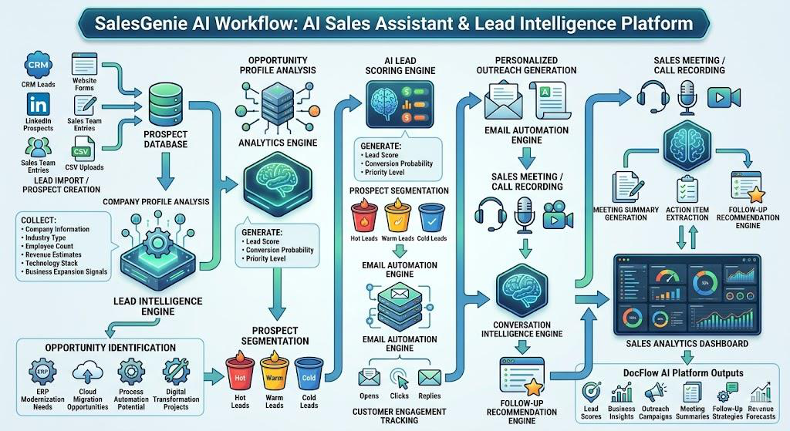
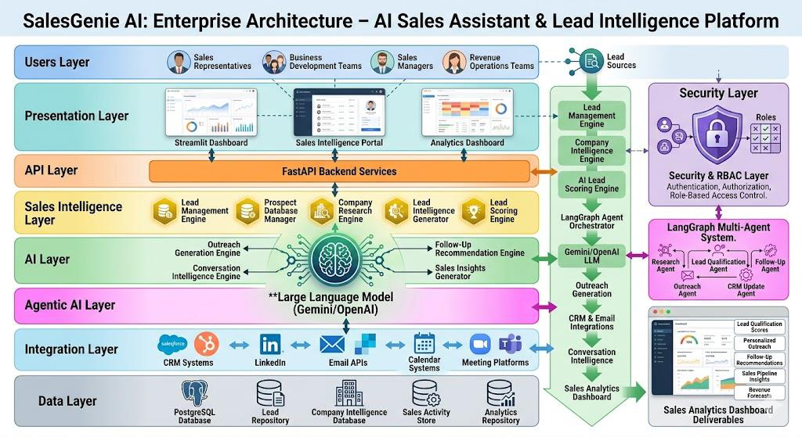
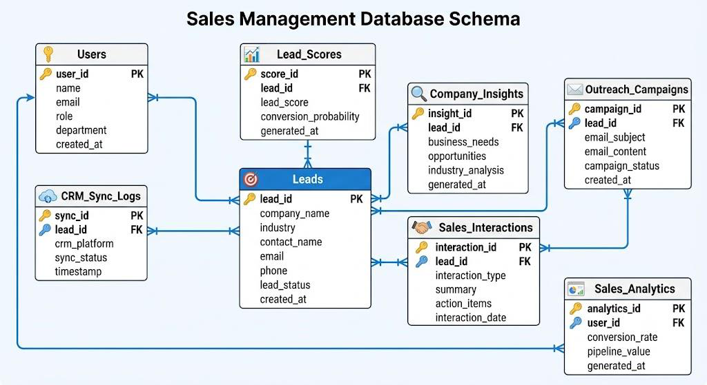

# SalesGenie AI — AI Sales Assistant & Lead Intelligence Platform

## 2. Project Statement

Modern sales teams spend a significant amount of time researching prospects, analysing company information, preparing outreach messages, tracking customer interactions, and identifying high-potential opportunities. Manual lead qualification and sales outreach often result in inconsistent engagement, lower conversion rates, and reduced productivity. This project aims to develop SalesGenie AI, an AI-powered Sales Assistant and Lead Intelligence Platform that automates lead analysis, prospect research, personalized outreach generation, sales conversation summarization, and follow-up recommendations. By leveraging Large Language Models (LLMs), agentic AI workflows, CRM integrations, and sales intelligence analytics, the platform enables sales teams to focus on relationship building and revenue generation. The solution improves lead conversion rates, streamlines sales operations, and enhances decision-making through actionable AI-driven insights.

## 3. Outcomes

- Centralized prospect and lead management platform.
- AI-powered company profile analysis and lead intelligence generation.
- Personalized cold email and outreach message generation.
- Automated lead scoring based on conversion probability.
- AI-generated follow-up strategies and sales recommendations.
- Meeting and sales conversation summarization.
- CRM integration for seamless sales workflow management.
- Sales performance analytics and business intelligence dashboard.

## 4. Modules to be Implemented

### 1. Lead Management & Prospect Database

- Create and manage prospect and customer records.
- Store company profiles, contact details, and engagement history.
- Track lead lifecycle and sales stages.

### 2. Lead Intelligence & Company Analysis

- Analyse company profiles and industry information.
- Identify potential business needs and opportunities.
- Generate lead insights and qualification scores.

### 3. AI Outreach Generation

- Generate personalized cold emails and sales messages.
- Create outreach content based on prospect profiles.
- Customize communication strategies for different industries.

### 4. Lead Scoring & Recommendation Engine

- Predict conversion likelihood using AI models.
- Assign lead scores based on engagement and company characteristics.
- Generate next-best-action recommendations.

### 5. Conversation Intelligence & CRM Integration

- Summarize sales calls, meetings, and customer interactions.
- Extract key discussion points and action items.
- Integrate with CRM platforms for activity synchronization.

### 6. Dashboard & Sales Analytics

- Interactive dashboard for lead tracking and sales performance.
- Monitor conversion rates, pipeline status, and outreach effectiveness.
- Generate sales intelligence and performance reports.

## 5. Week-wise Module Implementation & High-Level Requirements

### Milestone 1 (Weeks 1–2) — Lead Management & Intelligence Engine

- Develop prospect database and lead management system.
- Implement company profile analysis functionality.
- Generate AI-powered lead insights.

### Milestone 2 (Weeks 3–4) — Outreach Generation & Lead Scoring

- Implement personalized email generation.
- Develop lead scoring and qualification engine.
- Generate outreach recommendations and engagement strategies.

### Milestone 3 (Weeks 5–6) — CRM Integration & Conversation Intelligence

- Integrate CRM systems and sales workflows.
- Implement meeting and sales conversation summarization.
- Develop FastAPI endpoints for external integrations.

### Milestone 4 (Weeks 7–8) — Dashboard & Automation

- Develop sales analytics dashboard.
- Add automated follow-up recommendations.
- Perform testing, optimization, and deployment.

## 6. Evaluation Criteria

### Milestone 1 (Week 2)

- Successfully manage and analyze ≥95% of prospect records.
- Generate accurate company insights and lead intelligence.

### Milestone 2 (Week 4)

- Lead scoring accuracy ≥85%.
- Generate personalized outreach content for multiple industries.

### Milestone 3 (Week 6)

- CRM integration functions correctly across supported workflows.
- Sales conversation summaries generated successfully.

### Milestone 4 (Week 8)

- Dashboard fully operational.
- End-to-end sales intelligence workflow functional.
- Average lead analysis and outreach generation time <5 seconds.
- User satisfaction score ≥85% during testing and evaluation.

## 7. Workflow Diagram

## 8. Architecture Diagram

## 9. Database Schema

